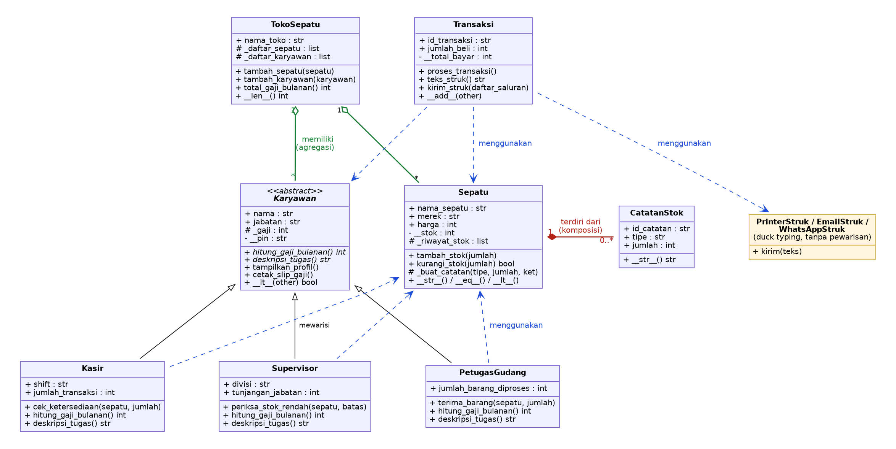

# Sistem Pengelolaan Penjualan dan Stok pada Toko Sepatu (Posttest 3)

Program ini mensimulasikan pengelolaan produk sepatu, karyawan, dan transaksi penjualan di sebuah toko sepatu. Posttest ini melanjutkan Posttest 2 (Relasi UML + Inheritance) dengan menambahkan **Abstraksi** (Abstract Base Class) dan **Polimorfisme** (via pewarisan, duck typing, dan operator overloading), serta menerapkan beberapa prinsip **SOLID** sebagai nilai plus.

- **Nama / NIM** : Reza Haikal / 2509106113
- **File program** : `2509106113_RezaHaikal_pt3.py`

---

## 1. Daftar Class

| Class | Peran | Keterangan |
|---|---|---|
| `CatatanStok` | Bagian dari `Sepatu` | Satu baris riwayat stok (MASUK/KELUAR) |
| `Sepatu` | Class produk | Data sepatu, stok private, riwayat stok. Operator: `__str__`, `__eq__`, `__lt__` |
| `Karyawan` | **Abstract Base Class** | Kontrak semua karyawan (2 abstract method + 2 method konkret). Tidak bisa diinstansiasi |
| `Kasir` | Subclass `Karyawan` | Atribut unik `shift`, `jumlah_transaksi` |
| `Supervisor` | Subclass `Karyawan` | Atribut unik `divisi`, `tunjangan_jabatan` |
| `PetugasGudang` | Subclass `Karyawan` (**baru**) | Atribut unik `jumlah_barang_diproses` |
| `TokoSepatu` | Penampung (agregasi) | Menampung sepatu dan karyawan. Operator: `__len__` |
| `Transaksi` | Proses penjualan | Menghitung total bayar, membuat & mengirim struk. Operator: `__add__`, `__radd__` |
| `PrinterStruk`, `EmailStruk`, `WhatsAppStruk` | Saluran pengiriman struk (**baru**) | Tidak berhubungan lewat pewarisan, semuanya punya `kirim(teks)` (duck typing) |

---

## 2. Relasi UML (Class Diagram)



**Cara membaca simbol**

| Garis | Arti | Warna di gambar |
|---|---|---|
| Garis putus-putus, panah terbuka (`..>`) | Asosiasi, "menggunakan" | Biru |
| Garis dengan wajik **kosong** di sisi induk (`o--`) | Agregasi, "memiliki" | Hijau |
| Garis dengan wajik **solid** di sisi induk (`*--`) | Komposisi, "terdiri dari" | Merah |
| Garis dengan segitiga kosong menunjuk ke induk | Pewarisan, "adalah jenis dari" | Hitam |

### 2.1 Asosiasi: `Kasir`, `Supervisor`, `PetugasGudang` ..> `Sepatu`

Objek `Sepatu` dibuat di luar lalu hanya **dikirim lewat parameter method** (`cek_ketersediaan(sepatu, jumlah)`, `periksa_stok_rendah(sepatu, batas)`, `terima_barang(sepatu, jumlah)`) dan tidak disimpan sebagai atribut milik karyawan, sehingga hubungannya longgar dan keduanya hidup mandiri. `Transaksi` juga memakai asosiasi: objek `Sepatu`, `Karyawan`, dan saluran struk dibuat di luar dan hanya diterima, bukan dibuat oleh `Transaksi`.

### 2.2 Agregasi: `TokoSepatu` o-- `Sepatu` dan `Karyawan`

`TokoSepatu` hanya **menampung referensi** objek `Sepatu` dan `Karyawan` yang dibuat di luar lewat `tambah_sepatu()` dan `tambah_karyawan()`. Alasan memilih agregasi: sepatu dan karyawan tetap bermakna meski tokonya bubar (karyawan bisa pindah kerja, sepatu bisa dijual di toko lain), dan terbukti di kode: setelah `del toko`, objek `sepatu1`, `kasir1`, dan `gudang1` masih bisa dipakai.

### 2.3 Komposisi: `Sepatu` *-- `CatatanStok`

Objek `CatatanStok` **dibuat langsung di dalam** `Sepatu` lewat `_buat_catatan()`, tidak pernah dibuat dari luar, dan hanya dimiliki satu `Sepatu`. Alasan memilih komposisi: riwayat stok tidak punya arti tanpa sepatu pemiliknya, sehingga siklus hidupnya bergantung penuh pada `Sepatu`. Terbukti di kode memakai `weakref`: setelah objek `Sepatu` dihapus, `CatatanStok` miliknya ikut musnah.

**Agregasi vs komposisi di program ini:** pertanyaan penentunya adalah "apakah bagian ini masih berguna kalau induknya hilang?". Karyawan dan sepatu masih berguna (agregasi), riwayat stok tidak (komposisi).

---

## 3. Abstraksi (Abstract Base Class)

`Karyawan` dijadikan abstract class dengan `ABC`:

| Elemen | Isi |
|---|---|
| Abstract method (2) | `hitung_gaji_bulanan()` dan `deskripsi_tugas()` |
| Method konkret (dipakai bersama) | `tampilkan_profil()` dan `cetak_slip_gaji()`: alurnya sama untuk semua karyawan, bagian yang berbeda dijawab oleh method abstrak milik tiap subclass (seperti `jalankan()` pada materi) |
| Subclass yang mengimplementasikan keduanya (3) | `Kasir`, `Supervisor`, `PetugasGudang` |

```python
class Karyawan(ABC):
    @abstractmethod
    def hitung_gaji_bulanan(self): ...

    @abstractmethod
    def deskripsi_tugas(self): ...

    def tampilkan_profil(self):            # method konkret, dipakai semua subclass
        print(f"Nama: {self.nama} | Jabatan: {self.jabatan} | ...")
        print(f"   -> Tugas: {self.deskripsi_tugas()}")
```

**Konsep inheritance dari Posttest 2 tetap dipakai:**

- `super().__init__(...)` dipanggil di `Kasir`, `Supervisor`, dan `PetugasGudang`.
- Atribut unik tiap subclass: `shift` / `jumlah_transaksi` (Kasir), `divisi` / `tunjangan_jabatan` (Supervisor), `jumlah_barang_diproses` (PetugasGudang).
- `_gaji` bersifat **protected** (dipakai langsung oleh subclass saat menghitung gaji), `__pin` bersifat **private** (hanya bisa diperiksa lewat `verifikasi_pin()`).

### Bukti abstract class tidak bisa diinstansiasi

```python
try:
    karyawan_langsung = Karyawan("Budi", "Umum", 3000000)
except TypeError as e:
    print("Karyawan(...) langsung -> TypeError:", e)
```

Output program:

```text
Abstract method milik Karyawan : ['deskripsi_tugas', 'hitung_gaji_bulanan']
Karyawan(...) langsung -> TypeError: Can't instantiate abstract class Karyawan without an implementation for abstract methods 'deskripsi_tugas', 'hitung_gaji_bulanan'
Subclass tidak lengkap -> TypeError: Can't instantiate abstract class KaryawanTidakLengkap without an implementation for abstract method 'deskripsi_tugas'
```

Baris ketiga membuktikan bahwa subclass yang lupa mengimplementasikan salah satu abstract method juga langsung ditolak saat objek dibuat.

---

## 4. Polimorfisme

### 4.1 Polimorfisme via Pewarisan

Method `hitung_gaji_bulanan()` di-override oleh tiga subclass dengan rumus berbeda, lalu dipanggil dalam **satu loop** yang berisi objek dari subclass berbeda:

| Subclass | Rumus gaji bulanan |
|---|---|
| `Kasir` | `_gaji` + (`jumlah_transaksi` x bonus per transaksi) |
| `Supervisor` | `_gaji` + `tunjangan_jabatan` |
| `PetugasGudang` | `_gaji` + (`jumlah_barang_diproses` x bonus per unit) |

```python
semua_karyawan = [kasir1, supervisor1, gudang1]
for k in semua_karyawan:
    k.cetak_slip_gaji()
```

```text
Slip gaji Dimas    (Kasir     ) : Rp3,860,000
Slip gaji Rina     (Supervisor) : Rp6,000,000
Slip gaji Joko     (Gudang    ) : Rp3,020,000
```

### 4.2 Duck Typing

`PrinterStruk`, `EmailStruk`, dan `WhatsAppStruk` **tidak berhubungan lewat pewarisan**, tetapi sama-sama punya `kirim(teks)`. Ketiganya dipanggil lewat satu fungsi yang sama, `distribusikan_struk()`:

```python
def distribusikan_struk(daftar_saluran, teks):
    for saluran in daftar_saluran:
        saluran.kirim(teks)
```

```text
[PRINTER Kasir-01] mencetak struk:
    ========== STRUK PEMBELIAN ==========
    ...
    Total Bayar : Rp1,603,950
    ======================================
[EMAIL -> pelanggan@mail.com] struk terkirim (8 baris)
[WHATSAPP -> 0812-3456-7890] struk terkirim (8 baris)
```

### 4.3 Operator Overloading

| Class | Magic method | Fungsi | Contoh pemakaian |
|---|---|---|---|
| `Sepatu` | `__str__` | Tampilan saat di-print | `print(sepatu1)` |
| `Sepatu` | `__eq__` | Sama jika nama, merek, ukuran sama | `sepatu1 == sepatu_kembar` |
| `Sepatu` | `__lt__` | Dibandingkan berdasarkan harga | `sorted(daftar_sepatu)` |
| `Karyawan` | `__str__`, `__lt__` | Dibandingkan berdasarkan gaji bulanan | `sorted(semua_karyawan, reverse=True)` |
| `TokoSepatu` | `__len__` | Jumlah sepatu di katalog | `len(toko)` |
| `Transaksi` | `__add__`, `__radd__` | Menjumlahkan total bayar | `transaksi1 + transaksi2`, `sum([...])` |

```text
str(sepatu1)                      : Nike Air Runner (ukuran 42) - Rp850,000
sepatu1 == sepatu_kembar (__eq__) : True
sepatu1 == sepatu2        (__eq__): False
sepatu1 < sepatu2         (__lt__): True
Karyawan terurut dari gaji bulanan terbesar (sorted -> __lt__):
    Rina (Supervisor) : Rp6,000,000
    Dimas (Kasir) : Rp3,860,000
    Joko (Gudang) : Rp3,020,000
transaksi1 + transaksi2 (__add__) : Rp5,599,950
sum([transaksi1, transaksi2])     : Rp5,599,950
```

### 4.4 Larangan Anti-Pattern

Tidak ada rantai `if / elif` yang mengecek `type()` atau string jenis untuk membedakan perilaku objek. Gaji, deskripsi tugas, dan pengiriman struk semuanya dijawab oleh method milik objek masing-masing. `isinstance()` hanya dipakai satu kali di `TokoSepatu.tambah_sepatu()` / `tambah_karyawan()` sebagai validasi masukan, bukan untuk membedakan perilaku.

---

## 5. Nilai Plus: Prinsip SOLID

| Prinsip | Bagian yang menerapkan |
|---|---|
| **OCP** (Open/Closed) | `PetugasGudang` ditambahkan sebagai subclass baru **tanpa mengubah satu baris pun** kode `Karyawan`, `Kasir`, `Supervisor`, maupun `TokoSepatu`. Loop gaji dan `TokoSepatu.total_gaji_bulanan()` langsung bekerja untuk jenis karyawan baru tersebut. |
| **DIP** (Dependency Inversion) | `Transaksi.kirim_struk(daftar_saluran)` menerima saluran pengiriman **dari luar** (dependency injection). `Transaksi` tidak membuat `PrinterStruk`/`EmailStruk` sendiri dan hanya bergantung pada kemampuan `kirim()`. |
| **SRP** (Single Responsibility) | Urusan pengiriman struk dipisah ke kelas saluran sendiri. `Transaksi` hanya menghitung transaksi dan menyusun teks struk lewat `teks_struk()`. |

---

## 6. Perubahan dari Posttest 2

- `Karyawan` sekarang **abstract class** (`ABC`). `tampilkan_profil()` tidak lagi di-override di subclass, tetapi menjadi method konkret yang memanggil `deskripsi_tugas()` milik subclass.
- `Karyawan.dari_dict()` dihapus dari superclass karena `Karyawan` tidak bisa dibuat langsung. `Kasir.dari_dict()` dan `Supervisor.dari_dict()` tetap ada.
- Ditambahkan `PetugasGudang`, saluran struk (duck typing), operator overloading, serta `teks_struk()` dan `kirim_struk()` pada `Transaksi`.
- Bukti komposisi diperkuat dengan `weakref`.

---

## 7. Cara Menjalankan

Kebutuhan: Python 3.8 atau lebih baru (tanpa library tambahan).

```bash
python 2509106113_RezaHaikal_pt3.py
```

Pastikan file `uml_class_diagram.png` berada satu folder dengan `README.md` agar gambar tampil.

---

## 8. Contoh Output Lengkap

```text
=======================================================================
  SELAMAT DATANG DI SISTEM PENGELOLAAN PENJUALAN DAN STOK TOKO SEPATU
======================================================================= 

--- 1. Membuat Objek Sepatu ---
[Nike] Air Runner | Ukuran: 42 | Harga: Rp850,000 | Stok: 20
[Adidas] UltraBoost | Ukuran: 40 | Harga: Rp1,200,000 | Stok: 15
Total produk terdaftar (atribut kelas): 2

--- 2. Bukti Abstraksi: Abstract Class Tidak Bisa Diinstansiasi ---
Abstract method milik Karyawan : ['deskripsi_tugas', 'hitung_gaji_bulanan']
Karyawan(...) langsung -> TypeError: Can't instantiate abstract class Karyawan without an implementation for abstract methods 'deskripsi_tugas', 'hitung_gaji_bulanan'
Subclass tidak lengkap -> TypeError: Can't instantiate abstract class KaryawanTidakLengkap without an implementation for abstract method 'deskripsi_tugas'

--- 3. Membuat Objek Karyawan (Subclass dari Abstract Class) ---
Nama: Dimas | Jabatan: Kasir | Perusahaan: Toko Sepatu Otep
   -> Tugas: melayani pembayaran pelanggan (shift Pagi, 0 transaksi ditangani)
Nama: Rina | Jabatan: Supervisor | Perusahaan: Toko Sepatu Otep
   -> Tugas: mengawasi operasional divisi Operasional (tunjangan Rp1,000,000)
Nama: Joko | Jabatan: Gudang | Perusahaan: Toko Sepatu Otep
   -> Tugas: mengelola penerimaan barang gudang (0 pasang diproses)
Total karyawan terdaftar (atribut kelas): 3
isinstance(kasir1, Karyawan)      : True
issubclass(Supervisor, Karyawan)  : True

--- 4. Uji Instance, Static & Class Method ---
Stok 'Air Runner' bertambah 5. Stok sekarang: 25
Gaji Dimas naik 10% menjadi Rp3,850,000
Validasi ukuran 42        : True
Validasi ukuran 60        : False
Validasi nama 'Dimas'     : True
Diskon member berhasil diubah menjadi 15%
Jam kerja standar diubah menjadi 9 jam/hari

--- 5. Relasi ASOSIASI (Kasir/Supervisor/PetugasGudang ..> Sepatu) ---
Kasir Dimas mengecek 'Air Runner' x2: TERSEDIA (stok 25)
Kasir Dimas mengecek 'UltraBoost' x100: TIDAK CUKUP (stok 15)
Supervisor Rina: stok 'Air Runner' menipis (25), segera restock!
Supervisor Rina: stok 'UltraBoost' aman (15).
Petugas gudang Joko menerima 10 pasang 'UltraBoost'
Stok 'UltraBoost' bertambah 10. Stok sekarang: 25

--- 6. Membuat & Memproses Transaksi ---
Transaksi TRX001 berhasil diproses oleh Dimas.

========== STRUK PEMBELIAN ==========
Toko        : Toko Sepatu Otep
ID Transaksi: TRX001
Kasir       : Dimas
Produk      : Air Runner (Nike)
Jumlah      : 2
Total Bayar : Rp1,603,950
======================================

Transaksi TRX002 berhasil diproses oleh Rina.

========== STRUK PEMBELIAN ==========
Toko        : Toko Sepatu Otep
ID Transaksi: TRX002
Kasir       : Rina
Produk      : UltraBoost (Adidas)
Jumlah      : 3
Total Bayar : Rp3,996,000
======================================

Stok 'UltraBoost' tidak cukup! Sisa stok: 22
Transaksi dibatalkan karena stok tidak mencukupi.

Struk TRX003 tidak dapat dicetak (status: GAGAL).

Total transaksi tercatat (atribut kelas): 3

--- 7. Relasi KOMPOSISI (Sepatu *-- CatatanStok) ---
Riwayat stok Air Runner:
  [STK-001] MASUK  +20 | Ket: Stok awal produk
  [STK-002] MASUK  +5 | Ket: Restock dari supplier
  [STK-003] KELUAR -2 | Ket: Penjualan
Riwayat stok UltraBoost:
  [STK-001] MASUK  +15 | Ket: Stok awal produk
  [STK-002] MASUK  +10 | Ket: Restock dari supplier
  [STK-003] KELUAR -3 | Ket: Penjualan

CatatanStok milik 'Court Classic' masih hidup? : True
Setelah Sepatu dihapus, CatatanStok masih ada?  : False

--- 8. Relasi AGREGASI (TokoSepatu o-- Sepatu & Karyawan) ---
  [+] Air Runner masuk katalog Toko Sepatu Otep
  [+] UltraBoost masuk katalog Toko Sepatu Otep
  [+] Dimas (Kasir) mulai bekerja di Toko Sepatu Otep
  [+] Rina (Supervisor) mulai bekerja di Toko Sepatu Otep
  [+] Joko (Gudang) mulai bekerja di Toko Sepatu Otep

  Toko Sepatu Otep - Samarinda
  Katalog sepatu (2):
    - Air Runner (Nike) stok 23
    - UltraBoost (Adidas) stok 22
  Pegawai (3):
    - Dimas (Kasir)
    - Rina (Supervisor)
    - Joko (Gudang)
len(toko) (operator overloading __len__) : 2
  [-] Joko telah berhenti dari Toko Sepatu Otep

Toko dibubarkan (del toko) ...
Objek tetap ada di memori setelah toko dihapus:
[Nike] Air Runner | Ukuran: 42 | Harga: Rp850,000 | Stok: 23
Nama: Dimas | Jabatan: Kasir | Perusahaan: Toko Sepatu Otep
   -> Tugas: melayani pembayaran pelanggan (shift Pagi, 1 transaksi ditangani)
Nama: Joko | Jabatan: Gudang | Perusahaan: Toko Sepatu Otep
   -> Tugas: mengelola penerimaan barang gudang (10 pasang diproses)

--- 9. Polimorfisme via Pewarisan (satu loop, tiga perilaku) ---
Slip gaji Dimas    (Kasir     ) : Rp3,860,000
Slip gaji Rina     (Supervisor) : Rp6,000,000
Slip gaji Joko     (Gudang    ) : Rp3,020,000

--- 10. Duck Typing (PrinterStruk, EmailStruk, WhatsAppStruk) ---
[PRINTER Kasir-01] mencetak struk:
    ========== STRUK PEMBELIAN ==========
    Toko        : Toko Sepatu Otep
    ID Transaksi: TRX001
    Kasir       : Dimas
    Produk      : Air Runner (Nike)
    Jumlah      : 2
    Total Bayar : Rp1,603,950
    ======================================
[EMAIL -> pelanggan@mail.com] struk terkirim (8 baris)
[WHATSAPP -> 0812-3456-7890] struk terkirim (8 baris)
Struk TRX003 tidak dapat dikirim (status: GAGAL).

--- 11. Operator Overloading ---
str(sepatu1)                      : Nike Air Runner (ukuran 42) - Rp850,000
sepatu1 == sepatu_kembar (__eq__) : True
sepatu1 == sepatu2        (__eq__): False
sepatu1 < sepatu2         (__lt__): True
Sepatu terurut dari termurah (sorted -> __lt__):
    Nike Air Runner (ukuran 42) - Rp850,000
    Nike Air Runner (ukuran 42) - Rp850,000
    Adidas UltraBoost (ukuran 40) - Rp1,200,000
Karyawan terurut dari gaji bulanan terbesar (sorted -> __lt__):
    Rina (Supervisor) : Rp6,000,000
    Dimas (Kasir) : Rp3,860,000
    Joko (Gudang) : Rp3,020,000
transaksi1 + transaksi2 (__add__) : Rp5,599,950
sum([transaksi1, transaksi2])     : Rp5,599,950

--- 12. Akses Protected / Private ---
Gaji pokok Dimas (protected via property) : Rp3,850,000
Gaji bulanan Dimas (+bonus)               : Rp3,860,000
PIN Dimas benar (1234)? : True
PIN Dimas benar (0000)? : False
Akses __pin ditolak (private): 'Kasir' object has no attribute '__pin'

--- 13. Uji Setter & Validasi Data ---
Stok sepatu2 sebelum diubah : 22
Stok sepatu2 setelah diubah (valid) : 50
Gagal mengubah stok (tidak valid) : Stok tidak boleh bernilai negatif!

Gaji supervisor1 sebelum diubah : 5000000
Gaji supervisor1 setelah diubah (valid) : 5500000
Gagal mengubah gaji (tidak valid) : Gaji tidak boleh bernilai negatif!

Total bayar transaksi1 saat ini : 1603950.0
Gagal mengubah total bayar (tidak valid) : Total bayar tidak boleh bernilai negatif!
```